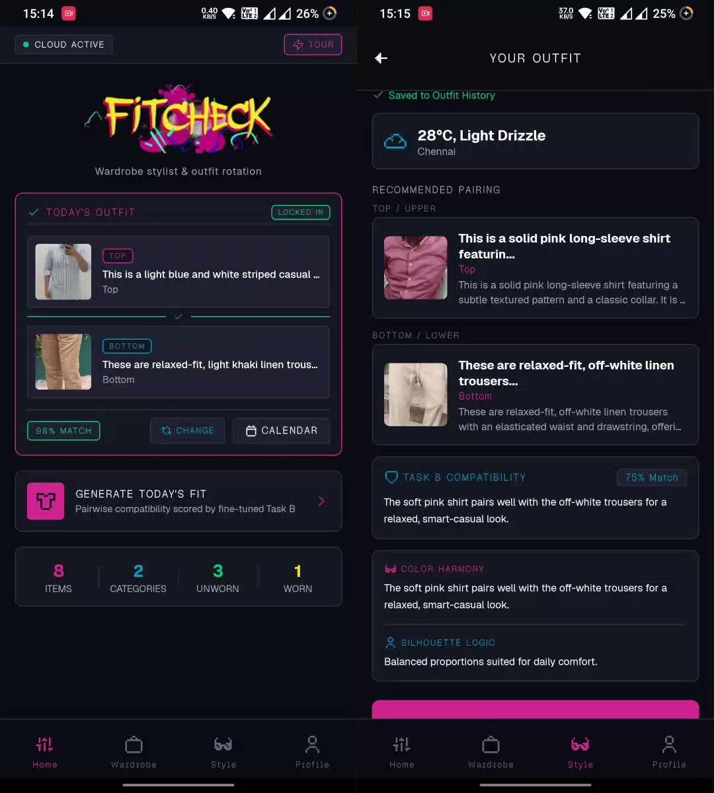

# FitCheck

FitCheck is an Android wardrobe assistant and daily outfit recommendation app built with React Native and Expo.
It pairs tops, bottoms, and layers from your own wardrobe using a fine-tuned vision-language model (Qwen3-VL 2B).

<p align="center">
  
</p>

<p align="center">
  <a href="https://github.com/barryallen16/fitcheck/releases/tag/v2.0.1">
    
  </a>
  <a href="https://barryallen16.github.io/fitcheck-website/">
    
  </a>
  <a href="https://huggingface.co/spaces/barryallen16/fitcheck">
    
  </a>
  <a href="https://ieeexplore.ieee.org/document/11681836/">
    
  </a>
</p>

## Highlights

* **Garment attribute extraction**: Takes photos of clothes and extracts category, formality, and color tags.
* **Compatibility scoring**: Uses a fine-tuned Qwen3-VL 2B model to score outfit pairings with specific style reasoning.
* **Daily outfit carousel**: Swipe horizontally through candidate outfits and tap Wear Today to record your pick.
* **Weather-aware recommendations**: Pulls local weather conditions from Open-Meteo to weight temperature and rain suitability.
* **7-day outfit calendar**: Logs worn outfits by date to prevent repeated combinations across the week.
* **Offline-first storage**: Stores photos and wardrobe data locally on device, with full JSON backup import and export.
* **Dual backend support**: Routes requests to a hosted Hugging Face Space by default, with local LM Studio fallback for offline inference.

## Live demo and web showcase

A desktop web showcase is live at [barryallen16.github.io/fitcheck-website](https://barryallen16.github.io/fitcheck-website/).
It lets you test the stylist without installing the mobile app:

* Interactive studio canvas with male and female wardrobe presets.
* Live Task A attribute analysis and Task B compatibility scoring using the fine-tuned model API.
* Real-time weather and temperature controls for outfit recommendations.
* Direct APK download link for Android devices.

## Research publication

The dataset distillation methods, fine-tuning procedure, and evaluation results are published in IEEE:

* IEEE Xplore: [IEEE Publication (Document 11681836)](https://ieeexplore.ieee.org/document/11681836/)
* Open-access PDF: [fitcheck-journal-paper.pdf](https://jayadithya.is-a.dev/fitcheck-journal-paper.pdf)

## Ecosystem

FitCheck spans three repositories and two inference backends:

* **FitCheck Mobile (`fitcheck`)**:
This repository contains the Expo React Native mobile application.
It handles camera uploads, local database storage, swipe deck gestures, and daily logs.
The interface uses Geist Pixel headers, Geist body typography, and custom retro pixel icons.

* **FitCheck Web (`fitcheck-website`)**:
The desktop web application built with React, Vite, and Tailwind CSS.
It runs the public showcase and browser demo, hosted on GitHub Pages.

* **FitCheck Human Evaluation (`fitcheck-human-eval`)**:
The evaluation portal used for the empirical user study in the IEEE paper.
It presented blind test batches of outfits to human reviewers to compare the fine-tuned model against baseline architectures.

* **Cloud Inference Space**:
Hosted inference backend on Hugging Face Spaces at [barryallen16/fitcheck](https://huggingface.co/spaces/barryallen16/fitcheck).

* **Local Model Weights**:
Quantized [Qwen3-VL-2B-Instruct GGUF](https://huggingface.co/barryallen16/FitCheck-Qwen3-VL-Stylist-GGUF) for running inference locally via LM Studio without internet access.

* **Model Collection**:
Datasets, weights, and spaces are indexed in the [FitCheck collection on Hugging Face](https://huggingface.co/collections/barryallen16/fitcheck).

## How it works

1. **Tagging (Task A)**:
When you photograph a garment, the vision model analyzes the image.
It assigns garment type, fabric texture, formality level, and color values.

2. **Styling and scoring (Task B)**:
The recommendation engine fetches local weather and filters candidate garments.
The fine-tuned model evaluates top, bottom, and layer combinations, outputs a compatibility score, and writes a style rationale covering color harmony and silhouette balance.

3. **Rotation and history**:
When you select Wear Today, FitCheck marks the items as worn and logs the entry to your 7-day calendar.
Unworn items receive higher ranking in future suggestions to maintain a balanced wardrobe rotation.

## Project structure

```text
fitcheck/
├── App.js
├── app.json
├── package.json
├── assets/
│   ├── fonts/
│   └── preview.jpg
└── src/
    ├── components/
    ├── config/
    ├── constants/
    ├── context/
    ├── navigation/
    ├── screens/
    ├── services/
    └── utils/
```

## Running the app

### Prerequisites

* Node.js (v18 or newer) and npm or Bun.
* Expo Go installed on an Android device, or a configured Android emulator.
* (Optional) LM Studio with Qwen3-VL-2B GGUF loaded if running inference locally.

### Installation

Clone the repository and install dependencies:

```bash
git clone https://github.com/barryallen16/fitcheck.git
cd fitcheck
npm install
```

### Configuration

Copy the example configuration file:

```bash
cp src/config/example.keys.js src/config/keys.js
```

Edit `src/config/keys.js` to configure your endpoints:

* `LMS_API_URL`: Optional OpenAI-compatible server URL.
Leave empty to use the default cloud endpoint.
* `LMS_KEYS`: API key for your custom server, if required.
* `LMS_MODEL`: Custom model identifier string.

`src/config/keys.js` is ignored by git to protect local keys.

### Backend modes

1. **Hosted Cloud Space (Default)**:
The app sends inference requests to `https://barryallen16-fitcheck.hf.space`.
No desktop setup or local GPU is required.

2. **Local LM Studio**:
Download the [Qwen3-VL-2B GGUF model](https://huggingface.co/barryallen16/FitCheck-Qwen3-VL-Stylist-GGUF).
Start the local server in LM Studio on port `1234`.
Set the server URL in app profile settings to your computer's local network IP address (for example `http://192.168.1.50:1234`).

### Start development server

```bash
npx expo start
```

Press `a` to open on an Android emulator or connected device via USB.
Scan the QR code with Expo Go to open on a physical phone.

### Prebuilt APK

You can download the compiled Android release build directly from the [Releases page](https://github.com/barryallen16/fitcheck/releases/tag/v2.0.1).
The APK supports `arm64-v8a` and `armeabi-v7a` architectures.
